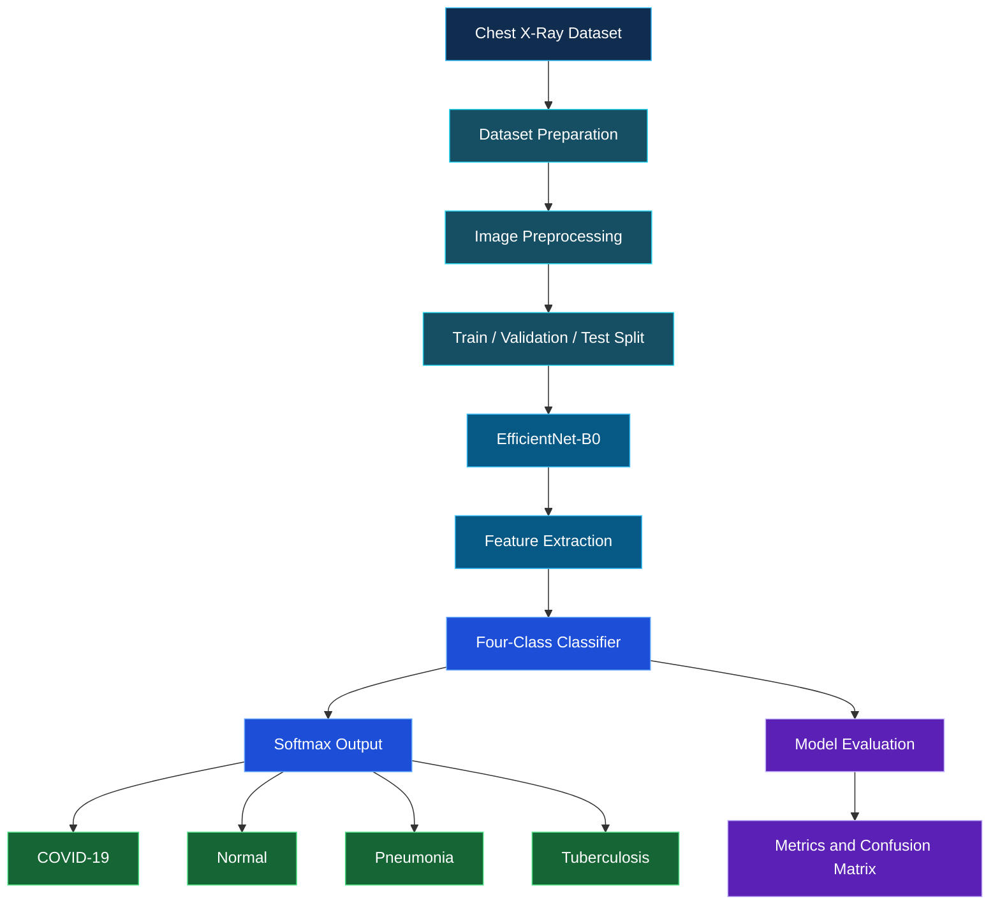

 <div align="center">

<!-- Animated Header -->


# PneumoNet

### Deep Learning Research Framework for Multi-Class Chest X-Ray Classification


<br/>


[Overview](#overview) · [Architecture](#system-architecture) · [Dataset](#dataset) · [Implementation](#current-implementation) · [Results](#model-performance) · [Artifacts](#project-artifacts) · [Roadmap](#research-roadmap)

</div>

---

## Overview

**PneumoNet** is an academic deep learning research project focused on the classification of chest X-ray images into four categories:

| Class | Description |
|---|---|
| COVID-19 | COVID-19 associated chest X-ray images |
| Normal | Chest X-ray images without the target abnormalities |
| Pneumonia | Pneumonia-associated chest X-ray images |
| Tuberculosis | Tuberculosis-associated chest X-ray images |

The broader research objective is to develop a comparative CNN framework using multiple deep learning architectures, including **EfficientNet, DenseNet, and ResNet**.

The current implementation phase focuses on **EfficientNet-B0**, using transfer learning with pretrained ImageNet weights and PyTorch.

### Research Scope

| Architecture | Project status |
|---|---|
| EfficientNet-B0 | Implemented and evaluated |
| DenseNet | Planned |
| ResNet | Planned |
| Comparative CNN evaluation | Planned |

---

## Research Objectives

- Develop a structured chest X-ray classification pipeline.
- Apply image preprocessing and normalization.
- Implement EfficientNet-B0 using transfer learning.
- Evaluate performance using accuracy, precision, recall, and F1-score.
- Analyze class-wise predictions and model errors.
- Establish a baseline for future CNN architecture comparison.
- Extend the framework towards explainability and application integration.

---

## System Architecture

The current implementation follows a pipeline from dataset preparation to model evaluation.

<!-- Add your system architecture image at this location -->
<div align="center">


**Figure: PneumoNet System Architecture**

</div>

> **Note:** Save your architecture diagram as `system_architecture.png` inside the `major project` directory. If you use a different filename or location, update the image path above.

### Experimental Workflow



### EfficientNet-B0 Architecture

EfficientNet-B0 uses compound scaling to balance network depth, width, and input resolution.

Its primary building block is **MBConv (Mobile Inverted Bottleneck Convolution)**, which incorporates:

- Expansion convolution
- Depthwise convolution
- Squeeze-and-Excitation attention
- Projection convolution
- Conditional residual connections

The original classification layer is replaced with a four-class output layer for PneumoNet.

---

## Technology Stack

| Component | Technology |
|---|---|
| Programming Language | Python |
| Deep Learning Framework | PyTorch |
| CNN Architecture | EfficientNet-B0 |
| Image Processing | PIL, Torchvision |
| Data Processing | NumPy, Pandas |
| Model Evaluation | Scikit-learn |
| Visualization | Matplotlib |
| Training Environment | Kaggle |
| GPU | NVIDIA Tesla T4 |
| Model Checkpoint | PyTorch `.pth` |

---

## Dataset

The prepared dataset contains **70,727 chest X-ray images** collected from multiple sources.

### Dataset Distribution

| Dataset Split | Images | Percentage |
|---|---:|---:|
| Training | 56,402 | 79.75% |
| Validation | 7,067 | 9.99% |
| Testing | 7,258 | 10.26% |
| **Total** | **70,727** | **100%** |

### Image Preprocessing

1. Dataset organization and label verification.
2. Image conversion to RGB format.
3. Image resizing to `224 × 224`.
4. ImageNet normalization.
5. Train, validation, and test split preparation.
6. Class-weighted loss to address class imbalance.

**Data integrity note:** Patient-level separation was checked for the NIH source where identifiers were available. Patient overlap could not be ruled out across every dataset source.

---

## Current Implementation

### EfficientNet-B0 Configuration

| Parameter | Configuration |
|---|---|
| Architecture | EfficientNet-B0 |
| Pretrained Weights | ImageNet |
| Input Resolution | 224 × 224 |
| Output Classes | 4 |
| Trainable Parameters | Approximately 4.01 million |
| Epochs | 5 |
| Batch Size | 32 |
| Optimizer | AdamW |
| Learning Rate | 0.0001 |
| Weight Decay | 0.0001 |
| Loss Function | Weighted Cross Entropy |
| Scheduler | ReduceLROnPlateau |
| Mixed Precision | Enabled on CUDA |
| GPU | NVIDIA Tesla T4 |

### Training Pipeline

```text
PRETRAINED EFFICIENTNET-B0
          |
          v
REPLACE ORIGINAL CLASSIFIER
          |
          v
INITIALIZE FOUR-CLASS MODEL
          |
          v
TRAIN WITH WEIGHTED LOSS
          |
          v
VALIDATE AFTER EACH EPOCH
          |
          v
SAVE BEST CHECKPOINT
          |
          v
FINAL TEST EVALUATION
```

---

## Model Performance

The trained EfficientNet-B0 model was evaluated on the prepared test split.

### Overall Test Metrics

| Metric | Score |
|---|---:|
| Accuracy | **98.48%** |
| Macro Precision | **90.95%** |
| Macro Recall | **96.27%** |
| Macro F1-Score | **93.47%** |

### Class-Wise Evaluation

| Class | Precision | Recall | F1-Score |
|---|---:|---:|---:|
| COVID-19 | 86.52% | 95.31% | 90.71% |
| Normal | 99.48% | 98.95% | 99.21% |
| Pneumonia | 91.12% | 93.33% | 92.22% |
| Tuberculosis | 86.67% | 97.50% | 91.76% |
| **Macro Average** | **90.95%** | **96.27%** | **93.47%** |

### Confusion Matrix

Rows represent actual labels; columns represent predicted labels.

| Actual / Predicted | COVID-19 | Normal | Pneumonia | Tuberculosis |
|---|---:|---:|---:|---:|
| COVID-19 | 122 | 3 | 0 | 3 |
| Normal | 16 | 6486 | 45 | 8 |
| Pneumonia | 2 | 30 | 462 | 1 |
| Tuberculosis | 1 | 1 | 0 | 78 |

<div align="center">


**Figure: PneumoNet Confusion Matrix**

</div>

### Training Progress

| Epoch | Training Loss | Validation Accuracy | Validation Macro F1 |
|---|---:|---:|---:|
| 1 | 0.2893 | 97.17% | 86.82% |
| 2 | 0.1274 | 97.57% | 88.69% |
| 3 | 0.1052 | 97.68% | 90.22% |
| 4 | 0.0823 | 97.92% | 92.05% |
| 5 | 0.0632 | 98.32% | 94.56% |

The model achieved its best validation macro F1-score in epoch 5.

**Evaluation note:** Accuracy should be interpreted alongside macro precision, recall, and F1-score because the dataset is class-imbalanced. These results represent performance on the prepared test split, not independent clinical validation.

---

## Project Artifacts

The repository includes the implementation resources and experiment outputs generated during the current phase.

### Model and Evaluation Outputs

| Artifact | Description |
|---|---|
| `best_pneumonet.pth` | Trained EfficientNet-B0 checkpoint |
| `metrics.json` | Overall evaluation metrics |
| `classification_report.csv` | Class-wise precision, recall, and F1-score |
| `confusion_matrix.csv` | Confusion matrix values |
| `confusion_matrix.png` | Confusion matrix visualization |
| `model_config.json` | Model configuration and metadata |
| `pneumonet_artifacts.zip` | Packaged experiment artifacts |
| `pneumonet_model.zip` | Packaged model checkpoint |

### Repository Resources

- [Browse project implementation and artifacts](./major%20project/)
- [View repository README](./README.md)
- [View all project files](https://github.com/Shashikala-11/pneumonet)

The `.pth` checkpoint contains the trained PyTorch model state and associated training metadata.

---

## Model Inference

The trained model can be reconstructed using PyTorch.

```python
import torch
import torch.nn as nn
from torchvision import models

class_names = [
    "COVID-19",
    "Normal",
    "Pneumonia",
    "Tuberculosis"
]

checkpoint = torch.load(
    "best_pneumonet.pth",
    map_location="cpu",
    weights_only=True
)

model = models.efficientnet_b0(weights=None)

features = model.classifier[1].in_features
model.classifier[1] = nn.Linear(features, 4)

model.load_state_dict(checkpoint["model_state_dict"])
model.eval()

print("EfficientNet-B0 loaded successfully.")
```

For image inference, apply the same RGB conversion, resizing, and ImageNet normalization used during training and evaluation.

---

## Research Roadmap

PneumoNet is envisioned as a multi-architecture comparative research framework.

| Research Component | Status |
|---|---|
| Dataset preparation | Completed |
| Image preprocessing | Completed |
| EfficientNet-B0 implementation | Completed |
| Model training and evaluation | Completed |
| Checkpoint and metrics export | Completed |
| System architecture documentation | In progress |
| DenseNet implementation | Planned |
| ResNet implementation | Planned |
| Comparative CNN evaluation | Planned |
| Explainable AI integration | Planned |
| Web application integration | Planned |
| External validation | Planned |

### Planned Comparative Analysis

Future experiments will compare the architectures using:

- Accuracy and macro F1-score
- Class-wise precision and recall
- Model parameter count and checkpoint size
- Training time and inference latency
- Generalization across independent data sources

---

## Limitations and Responsible Use

- Dataset imbalance may influence classification performance.
- Differences between data sources may affect model generalization.
- Patient-level separation could not be confirmed for every source.
- Softmax scores are not calibrated clinical probabilities.
- Independent external clinical validation has not been completed.
- The current implementation is limited to EfficientNet-B0.

**PneumoNet is an academic research prototype, not a medical diagnostic system.** It must not be used as a substitute for professional medical evaluation or clinical decision-making.

---

## Getting Started

### Clone the Repository

```bash
git clone https://github.com/Shashikala-11/pneumonet.git
cd pneumonet
```

### Install Dependencies

```bash
pip install torch torchvision numpy pandas pillow scikit-learn matplotlib
```

### Load the Model

Place the trained `best_pneumonet.pth` checkpoint in your working directory and follow the inference example above.

---

## References

1. M. Tan and Q. V. Le, "EfficientNet: Rethinking Model Scaling for Convolutional Neural Networks," ICML, 2019.
2. G. Huang et al., "Densely Connected Convolutional Networks," CVPR, 2017.
3. K. He et al., "Deep Residual Learning for Image Recognition," CVPR, 2016.
4. P. Rajpurkar et al., "CheXNet: Radiologist-Level Pneumonia Detection on Chest X-Rays with Deep Learning," arXiv:1711.05225, 2017.
5. L. Wang et al., "COVID-Net: A Tailored Deep Convolutional Neural Network Design for Detection of COVID-19 Cases from Chest X-Ray Images," Scientific Reports, 2020.

---

<div align="center">


### PNEUMONET

**Deep Learning. Medical Imaging. Comparative Research.**

Academic Research Project | EfficientNet-B0 Implementation

[GitHub Repository](https://github.com/Shashikala-11/pneumonet)


</div>