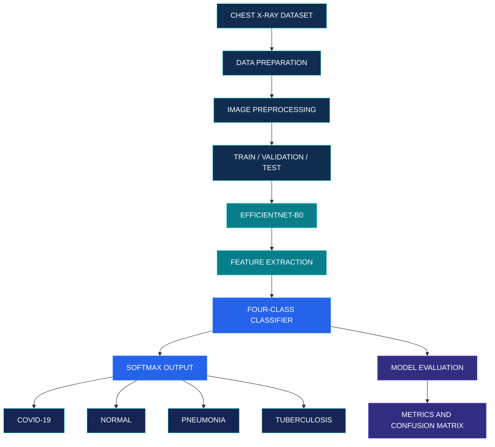

<div align="center">


<br/>


<br/><br/>

<a href="#overview">

</a>
<a href="#implementation">

</a>
<a href="#performance">

</a>

<br/><br/>

**A deep learning research framework for multi-class chest X-ray image classification.**

[Overview](#overview) ·
[Architecture](#architecture) ·
[Implementation](#implementation) ·
[Performance](#performance) ·
[Research Roadmap](#research-roadmap)

<br/>


</div>

---

<a id="overview"></a>

## 01 / Project Overview

**PneumoNet** is an academic deep learning research project focused on automated classification of chest X-ray images into four categories:

| Classification | Description |
|:---|:---|
| COVID-19 | COVID-19 associated chest X-ray images |
| Normal | Images without the target abnormalities |
| Pneumonia | Pneumonia-associated chest X-ray images |
| Tuberculosis | Tuberculosis-associated chest X-ray images |

The broader research vision is to establish a comparative CNN framework using EfficientNet, DenseNet and ResNet architectures.

The current implementation phase focuses on **EfficientNet-B0**, developed using transfer learning and PyTorch.

<div align="center">


</div>

## 02 / Research Objectives

- Develop a structured chest X-ray image classification pipeline.
- Apply preprocessing and normalization to medical images.
- Implement EfficientNet-B0 using pretrained ImageNet weights.
- Evaluate classification performance using multiple metrics.
- Establish a baseline for future CNN architecture comparison.
- Investigate model generalization, interpretability and computational efficiency.
- Develop an application interface for model inference in a future phase.

---

<a id="architecture"></a>

## 03 / System Architecture

The current experimental pipeline consists of dataset preparation, image preprocessing, EfficientNet-B0 feature extraction, four-class prediction and evaluation.



### EfficientNet-B0 Feature Extraction

EfficientNet-B0 is based on compound scaling, which balances network depth, width and input resolution.

Its core building block is MBConv (Mobile Inverted Bottleneck Convolution), incorporating:

- Expansion convolution
- Depthwise convolution
- Squeeze-and-Excitation attention
- Projection convolution
- Conditional residual connections

The original classification head is replaced with a four-class output layer for PneumoNet.

---

## 04 / Technology Stack

<div align="center">


<br/><br/>


</div>

| Layer | Technology |
|:---|:---|
| Programming | Python |
| Deep Learning | PyTorch |
| CNN Architecture | EfficientNet-B0 |
| Image Processing | PIL, Torchvision |
| Data Processing | NumPy, Pandas |
| Evaluation | Scikit-learn |
| Visualization | Matplotlib |
| Training Environment | Kaggle |
| GPU | NVIDIA Tesla T4 |
| Model Format | PyTorch `.pth` |

---

## 05 / Dataset Engineering

The prepared dataset contains **70,727 chest X-ray images** collected from multiple sources.

<div align="center">

| Dataset Split | Image Count | Distribution |
|:---|---:|---|
| Training | 56,402 | 79.75% |
| Validation | 7,067 | 9.99% |
| Testing | 7,258 | 10.26% |
| **Total** | **70,727** | **100%** |

</div>

### Preprocessing Pipeline

1. Dataset organization and label verification.
2. Image conversion to RGB.
3. Image resizing to 224 × 224.
4. ImageNet normalization.
5. Train, validation and test split preparation.
6. Class-weighted loss for imbalanced classification.

**Data integrity note:** Patient-level separation was checked for the NIH source where identifiers were available. Patient overlap could not be ruled out for all other sources.

---

<a id="implementation"></a>

## 06 / Current Implementation

### EfficientNet-B0 Training Configuration

| Configuration | Value |
|:---|:---|
| Architecture | EfficientNet-B0 |
| Pretrained Weights | ImageNet |
| Input Resolution | 224 × 224 |
| Number of Classes | 4 |
| Trainable Parameters | ~4.01 Million |
| Training Epochs | 5 |
| Batch Size | 32 |
| Optimizer | AdamW |
| Learning Rate | 0.0001 |
| Weight Decay | 0.0001 |
| Loss Function | Weighted Cross Entropy |
| Scheduler | ReduceLROnPlateau |
| Mixed Precision | CUDA |
| Hardware | NVIDIA Tesla T4 |

### Training Workflow

```text
PRETRAINED EFFICIENTNET-B0
          |
          v
REPLACE ORIGINAL CLASSIFIER
          |
          v
INITIALIZE FOUR-CLASS MODEL
          |
          v
TRAIN WITH WEIGHTED LOSS
          |
          v
VALIDATE AFTER EACH EPOCH
          |
          v
SAVE BEST CHECKPOINT
          |
          v
FINAL TEST EVALUATION
```

---

<a id="performance"></a>

## 07 / Model Performance

<div align="center">

<table>
<tr>
<td align="center" width="25%">
<h2 style="color:#087E8B">98.48%</h2>
<strong>Accuracy</strong>
</td>
<td align="center" width="25%">
<h2 style="color:#2563EB">90.95%</h2>
<strong>Macro Precision</strong>
</td>
<td align="center" width="25%">
<h2 style="color:#8B5CF6">96.27%</h2>
<strong>Macro Recall</strong>
</td>
<td align="center" width="25%">
<h2 style="color:#0D9488">93.47%</h2>
<strong>Macro F1</strong>
</td>
</tr>
</table>

</div>

### Class-wise Evaluation

| Class | Precision | Recall | F1-Score |
|:---|---:|---:|---:|
| COVID-19 | 86.52% | 95.31% | 90.71% |
| Normal | 99.48% | 98.95% | 99.21% |
| Pneumonia | 91.12% | 93.33% | 92.22% |
| Tuberculosis | 86.67% | 97.50% | 91.76% |
| **Macro Average** | **90.95%** | **96.27%** | **93.47%** |

### Confusion Matrix

| Actual / Predicted | COVID-19 | Normal | Pneumonia | TB |
|:---|---:|---:|---:|---:|
| COVID-19 | 122 | 3 | 0 | 3 |
| Normal | 16 | 6486 | 45 | 8 |
| Pneumonia | 2 | 30 | 462 | 1 |
| Tuberculosis | 1 | 1 | 0 | 78 |

### Training Progress

| Epoch | Training Loss | Validation Accuracy | Validation Macro F1 |
|---:|---:|---:|---:|
| 1 | 0.2893 | 97.17% | 86.82% |
| 2 | 0.1274 | 97.57% | 88.69% |
| 3 | 0.1052 | 97.68% | 90.22% |
| 4 | 0.0823 | 97.92% | 92.05% |
| 5 | 0.0632 | 98.32% | 94.56% |

**Evaluation interpretation:** The current model demonstrates promising results on the prepared test split. The difference between accuracy and macro F1 highlights the importance of class-wise evaluation in an imbalanced dataset.

---

## 08 / Model Artifacts

The current experiment generates the following outputs:

```text
pneumonet_results/
│
├── best_pneumonet.pth
├── metrics.json
├── classification_report.csv
├── confusion_matrix.csv
├── confusion_matrix.png
└── model_config.json
```

The `.pth` checkpoint stores the trained model state and associated training metadata.

---

## 09 / Model Inference

The trained EfficientNet-B0 checkpoint can be reconstructed using PyTorch.

```python
import torch
import torch.nn as nn
from torchvision import models

class_names = [
    "COVID-19",
    "Normal",
    "Pneumonia",
    "Tuberculosis"
]

checkpoint = torch.load(
    "best_pneumonet.pth",
    map_location="cpu",
    weights_only=True
)

model = models.efficientnet_b0(weights=None)

features = model.classifier[1].in_features
model.classifier[1] = nn.Linear(features, 4)

model.load_state_dict(checkpoint["model_state_dict"])
model.eval()

print("EfficientNet-B0 loaded successfully.")
```

The inference pipeline must apply the same resizing, RGB conversion and normalization used during model evaluation.

---

<a id="research-roadmap"></a>

## 10 / Research Roadmap

PneumoNet is envisioned as a multi-CNN comparative research framework.

| Research Component | Status |
|:---|:---|
| Dataset preparation | Completed |
| Image preprocessing | Completed |
| EfficientNet-B0 implementation | Completed |
| Model training and evaluation | Completed |
| Checkpoint and metrics export | Completed |
| DenseNet implementation | Planned |
| ResNet implementation | Planned |
| Multi-CNN comparison | Planned |
| Explainable AI integration | Planned |
| Web application integration | Planned |
| External validation | Planned |

### Planned Comparative Analysis

Future experiments will evaluate architectures under comparable conditions using:

- Accuracy and macro F1-score
- Class-wise precision and recall
- Model parameter count and checkpoint size
- Training time and inference latency
- Generalization across independent data sources

---

## 11 / Limitations and Responsible Use

- Dataset imbalance may influence classification performance.
- Source-related differences may affect generalization.
- Patient-level separation could not be confirmed for every source.
- Softmax scores are not calibrated clinical probabilities.
- External clinical validation has not been completed.

**PneumoNet is an academic research prototype, not a medical diagnostic system. It must not be used as a substitute for professional medical evaluation.**

---

## 12 / Getting Started

### Clone the Repository

```bash
git clone https://github.com/YOUR_USERNAME/PneumoNet.git
cd PneumoNet
```

### Install Dependencies

```bash
pip install torch torchvision numpy pandas pillow scikit-learn matplotlib
```

### Load the Model

Follow the inference example in Section 09 after placing the downloaded checkpoint in the project directory.

---

## 13 / References

1. M. Tan and Q. V. Le, "EfficientNet: Rethinking Model Scaling for Convolutional Neural Networks," ICML, 2019.
2. G. Huang et al., "Densely Connected Convolutional Networks," CVPR, 2017.
3. K. He et al., "Deep Residual Learning for Image Recognition," CVPR, 2016.
4. P. Rajpurkar et al., "CheXNet: Radiologist-Level Pneumonia Detection on Chest X-Rays with Deep Learning," arXiv:1711.05225, 2017.
5. L. Wang et al., "COVID-Net: A Tailored Deep Convolutional Neural Network Design for Detection of COVID-19 Cases from Chest X-Ray Images," Scientific Reports, 2020.

---

<div align="center">


**PNEUMONET**

*Deep Learning. Medical Imaging. Comparative Research.*

<sub>Academic Research Project | EfficientNet-B0 Implementation</sub>

</div>
